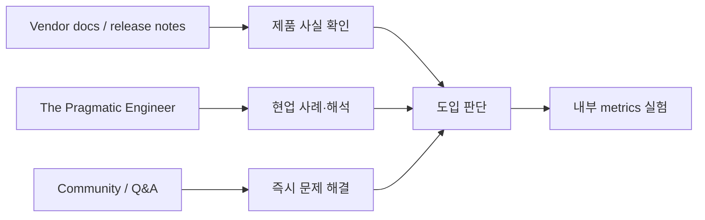

# The Pragmatic Engineer — Ecosystem

[[tech/devtools/the-pragramitic-engineer/README|학습 진입점]] · 다음: [[tech/devtools/the-pragramitic-engineer/03-references|References]]

## 비교

| 대상 | 주된 가치 | The Pragmatic Engineer와의 차이 | 함께 쓰는 방식 |
|---|---|---|---|
| The Pragmatic Engineer | 현업 사례 기반 engineering/AI industry intelligence | 유료 Deepdive와 insider-style analysis가 중심 | 사례를 가설·정책 초안으로 사용 |
| LeadDev | Engineering leadership 기사·행사·커뮤니티 | manager/leadership education 비중이 더 크고 회사 내부 취재 깊이는 주제별로 다름 | 사람·조직 운영 관점 보완 |
| The Changelog | Open source·developer culture 중심 podcast/media | audio·OSS 생태계 폭이 강점, market/조직 분석은 상대적으로 덜 집중 | 특정 OSS와 maintainer 신호 탐색 |
| InfoQ | architecture·software development 기술 기사 | 기술 패턴과 conference knowledge에 강점 | architecture pattern의 개념 검증 |
| Stack Overflow / 개발자 커뮤니티 | 질문·답변과 집단 지식 | 즉시 문제 해결에는 유리하나 usage 변화와 품질 편차가 있음 | code-level 해결 후 원문으로 재확인 |
| vendor blogs | 제품·API의 1차 정보 | product spec에는 최적이나 독립 비교·조직 영향 분석은 별도 검증 필요 | release·가격·제약의 기준 소스로 사용 |

## 소스 역할 분리

이 매체의 글은 도입 판단의 **해석 층**에 놓는다. 예를 들어 Claude Code나 Codex의 capability·가격·privacy는 vendor 문서로 확인하고, 실제 adoption의 review 부담이나 조직 변화는 사례와 내부 실험으로 확인한다.

## 선택 기준

- “무엇을 지원하는가”는 공식 문서로 확인한다.
- “다른 팀은 어떤 trade-off를 겪었는가”는 Deepdive와 Podcast로 탐색한다.
- “우리에게 효과가 있는가”는 baseline과 rollout으로 판단한다.
- 매체 간 의견이 다르면 발행일, 인용한 원문, 적용 대상의 규모를 비교한다.

## Sources

- [The Pragmatic Engineer Archive](https://newsletter.pragmaticengineer.com/archive?sort=new)
- [LeadDev](https://leaddev.com/)
- [The Changelog](https://changelog.com/)
- [InfoQ](https://www.infoq.com/)
- [OpenAI Developers](https://platform.openai.com/docs)
- [Anthropic Documentation](https://docs.anthropic.com/)
